# Agile Planning & DevOps Workflow Guide
## Project: Automated Controlled Document Version Approval System

---

## 1. Product Backlog & 15 User Stories

| ID | User Story | Acceptance Criteria | Story Points | Priority |
|---|---|---|---|---|
| **US-01** | *As an Author*, I want to create a new controlled document draft so that I can prepare specifications or SOPs. | Form accepts Title, Category, Author, and Content. Auto-assigns doc ID and initial version 1.0 in `DRAFT` status. | 3 | High |
| **US-02** | *As an Author*, I want to validate document inputs so that no empty or invalid submissions occur. | Title must be >= 5 chars, Author must be specified, Category must be from allowed enum (`SOP`, `Policy`, `Specification`, `Manual`). | 2 | High |
| **US-03** | *As an Author*, I want to submit a draft for approval so that designated reviewers are notified. | Status changes from `DRAFT` to `PENDING_APPROVAL`. Audit log records submission event. | 3 | High |
| **US-04** | *As a Reviewer*, I want to see a filtered list of all documents awaiting approval so that I can take timely action. | Dedicated dashboard tab/filter displaying documents with status `PENDING_APPROVAL`. | 2 | High |
| **US-05** | *As a Reviewer*, I want to approve a pending document with remarks so that it becomes formally authorized. | Status updates to `APPROVED`. Reviewer name and timestamp recorded in document and audit log. | 3 | High |
| **US-06** | *As a Reviewer*, I want to reject a pending document with mandatory feedback remarks so that the author knows what to revise. | System prevents rejection without comments. Status changes to `REJECTED`. Author notified via status badge. | 3 | High |
| **US-07** | *As a QA Auditor*, I want to view all document versions so that I can inspect the full historical lineage. | Version timeline shows all versions (e.g., v1.0, v1.1, v2.0) with change summaries and timestamps. | 5 | High |
| **US-08** | *As an Author*, I want to create a minor version bump (e.g. 1.0 -> 1.1) for minor corrections. | Version number incremented by 0.1; new revision created in `PENDING_APPROVAL` status. | 3 | Medium |
| **US-09** | *As an Author*, I want to create a major version bump (e.g. 1.1 -> 2.0) for major policy changes. | Version number incremented to next integer.0; change summary recorded. | 3 | Medium |
| **US-10** | *As a Compliance Auditor*, I want an immutable chronological audit trail so that regulatory compliance is guaranteed. | Log contains timestamp, actor, action, and details. Read-only API; no delete or update permitted. | 5 | High |
| **US-11** | *As a User*, I want real-time document search and status filtering so that I can find documents quickly. | Search by Title or Doc Number; filter by Status (`ALL`, `DRAFT`, `PENDING_APPROVAL`, `APPROVED`, `RELEASED`). | 2 | Medium |
| **US-12** | *As a Release Manager*, I want to release approved documents to production so that teams can use the latest authorized version. | Transition from `APPROVED` to `RELEASED`. Status badge turns bright green. | 2 | Medium |
| **US-13** | *As a DevOps Engineer*, I want an automated health check endpoint so that monitoring tools can verify uptime. | Endpoint `/api/health` returns HTTP 200 with status `UP`, timestamp, and JVM memory stats. | 1 | High |
| **US-14** | *As a DevOps Engineer*, I want a standardized Maven build and automated test suite so that regressions are blocked in CI. | `mvn clean test` runs unit and mock tests; fails build if any test fails. | 5 | High |
| **US-15** | *As a DevOps Engineer*, I want a containerized Docker deployment so that the application runs identically across all environments. | Multi-stage Dockerfile packages the Spring Boot JAR with embedded Tomcat into a lightweight container. | 5 | High |

---

## 2. 15-Task Kanban / Sprint Plan

### Sprint 1: Core Architecture & MVP Implementation (Tasks 1 - 8)
- **Task 1 (To Do -> Done):** Finalize SRS, Use Cases, Architecture, and Data Model.
- **Task 2 (To Do -> Done):** Setup Maven multi-tier structure with Java 17 and Spring Boot Web.
- **Task 3 (To Do -> Done):** Implement Domain Entities (`Document`, `DocumentVersion`, `ApprovalStatus`, `AuditLog`).
- **Task 4 (To Do -> Done):** Build Thread-Safe In-Memory Repository Layer.
- **Task 5 (To Do -> Done):** Implement Document Service Layer (State Machine & Version Logic).
- **Task 6 (To Do -> Done):** Implement Audit Trail Service with Immutable Event Generation.
- **Task 7 (To Do -> Done):** Build RESTful API Controllers (`/api/documents/**`, `/api/health`).
- **Task 8 (To Do -> Done):** Implement Request Validation & Exception Handling.

### Sprint 2: Web Dashboard & Frontend Interactivity (Tasks 9 - 12)
- **Task 9 (To Do -> Done):** Build Glassmorphic Dashboard Layout (HTML5 / Vanilla CSS3).
- **Task 10 (To Do -> Done):** Implement Document Submission Modal & Real-Time Form Validation.
- **Task 11 (To Do -> Done):** Build Reviewer Approval Queue Modal (Approve / Reject actions with feedback).
- **Task 12 (To Do -> Done):** Implement Version History & Audit Trail Viewer with chronological timeline.

### Sprint 3: CI/CD, Quality Gates & Deployment (Tasks 13 - 15)
- **Task 13 (To Do -> Done):** Implement JUnit 5 test suite covering validation, state transitions, and audit logs.
- **Task 14 (To Do -> Done):** Create Dockerfile and multi-stage build for containerized Tomcat deployment.
- **Task 15 (To Do -> Done):** Create Jenkinsfile Pipeline-as-Code with Checkout, Build, Test, Package, and Deploy stages.

---

## 3. Definition of Done (DoD)

A user story or task is marked as **Done** when:
1. **Code Completeness:** Source code adheres to clean Java 17 standards with clear separation of concerns (Controller, Service, Repository, Model).
2. **Automated Testing:** All unit tests pass with zero errors (`mvn test`).
3. **API Contract Verification:** All REST endpoints return expected HTTP status codes (`200 OK`, `201 Created`, `400 Bad Request`, `404 Not Found`).
4. **Audit Compliance:** Every state change and version increment generates a corresponding immutable audit record.
5. **UI Validation:** User interface renders correctly on modern desktop browsers with zero console errors.
6. **Containerization:** The Docker image builds cleanly and runs on port 8080.
7. **Documentation:** API specifications, SRS, and deployment guides are updated in the `docs/` folder.

---

## 4. DevOps Lifecycle Workflow Diagram (Mermaid)

```mermaid
flowchart LR
    subgraph PlanPhase ["1. Plan"]
        Backlog["Product Backlog\n(15-Task Kanban)"]
        UserStories["User Stories &\nAcceptance Criteria"]
    end

    subgraph CodePhase ["2. Code"]
        GitBranch["Feature Branching\n(feature/task-X)"]
        Commit["Git Commits\n(Conventional Commits)"]
    end

    subgraph BuildPhase ["3. Build (CI)"]
        JenkinsWebhook["Jenkins CI Trigger\n(Commit / Polling)"]
        MavenBuild["Maven 3.9 Compiler\n(mvn clean package)"]
    end

    subgraph TestPhase ["4. Test (Quality Gate)"]
        UnitTests["JUnit 5 Unit Tests"]
        SeleniumTests["Selenium WebDriver E2E\n(Critical User Journeys)"]
    end

    subgraph PackagePhase ["5. Release"]
        DockerBuild["Docker Multi-Stage Build\n(Dockerfile)"]
        DockerTag["Version Tagging\n(v1.0.0, latest)"]
    end

    subgraph DeployPhase ["6. Deploy (CD)"]
        TomcatContainer["Apache Tomcat Container\n(Port 8080:8080)"]
        AnsibleProvision["Ansible / Puppet\nConfiguration Management"]
    end

    subgraph MonitorPhase ["7. Operate & Monitor"]
        HealthEndpoint["Health Check Probe\n(/api/health)"]
        AuditInspection["Audit Trail Inspection"]
    end

    Backlog --> UserStories
    UserStories --> GitBranch
    GitBranch --> Commit
    Commit --> JenkinsWebhook
    JenkinsWebhook --> MavenBuild
    MavenBuild --> UnitTests
    UnitTests --> SeleniumTests
    SeleniumTests -->|Passed| DockerBuild
    DockerBuild --> DockerTag
    DockerTag --> AnsibleProvision
    AnsibleProvision --> TomcatContainer
    TomcatContainer --> HealthEndpoint
    HealthEndpoint --> AuditInspection
```

