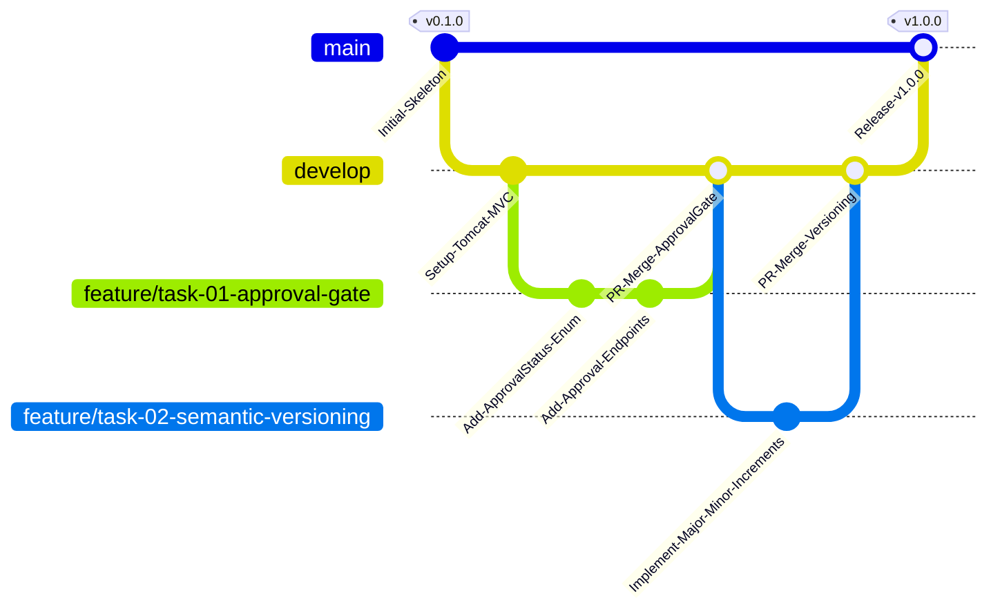

# Git Branching & Collaboration Policy
## Project: Automated Controlled Document Version Approval System

---

## 1. Branch Strategy (GitFlow Adapted for DevOps CI/CD)

---

## 2. Branch Naming Rules

| Branch Type | Naming Pattern | Example | Purpose |
|---|---|---|---|
| **Production** | `main` | `main` | Production-ready, tagged releases only. Protected branch. |
| **Integration** | `develop` | `develop` | Daily development integration branch. Target for all PRs. |
| **Feature** | `feature/<task-id>-<short-description>` | `feature/task-05-approval-service` | New user story or functionality implementation. |
| **Bugfix** | `bugfix/<issue-id>-<short-description>` | `bugfix/issue-12-null-reviewer-check` | Non-emergency defect corrections. |
| **Hotfix** | `hotfix/<version>-<short-description>` | `hotfix/v1.0.1-security-patch` | Critical production patches branched directly from `main`. |
| **Release** | `release/v<major>.<minor>.<patch>` | `release/v1.0.0` | Release preparation, final testing & version tagging. |

---

## 3. Commit Message Standards (Conventional Commits)

Format: `<type>(<scope>): <subject>`

- **feat:** A new feature (e.g. `feat(approval): add electronic signature validation`)
- **fix:** A bug fix (e.g. `fix(versioning): prevent duplicate version numbers`)
- **docs:** Documentation changes (e.g. `docs(srs): update architecture diagram`)
- **style:** Formatting, CSS styling (e.g. `style(ui): improve glassmorphism card contrast`)
- **refactor:** Code restructuring without changing behavior (e.g. `refactor(service): streamline state machine transitions`)
- **test:** Adding or updating tests (e.g. `test(junit): add rejection workflow assertions`)
- **ci:** Changes to CI/CD pipelines (e.g. `ci(jenkins): configure Maven surefire report publisher`)

---

## 4. Pull Request & Code Review Policy

1. **Self-Review:** Author verifies code builds locally with zero errors (`mvn clean test`).
2. **Pull Request Creation:** Raise PR against `develop` with filled-out PR template.
3. **Automated CI Quality Gate:** Jenkins must report successful build and 100% test pass.
4. **Peer Review:** At least 1 peer approval required.
5. **Merge Strategy:** Squash and merge or rebase merge to keep a clean, linear git log.
