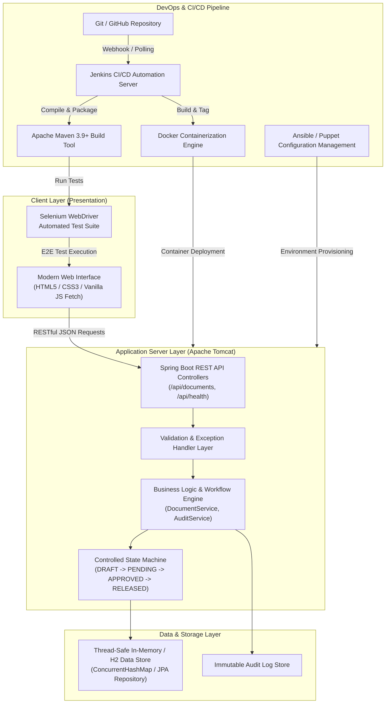
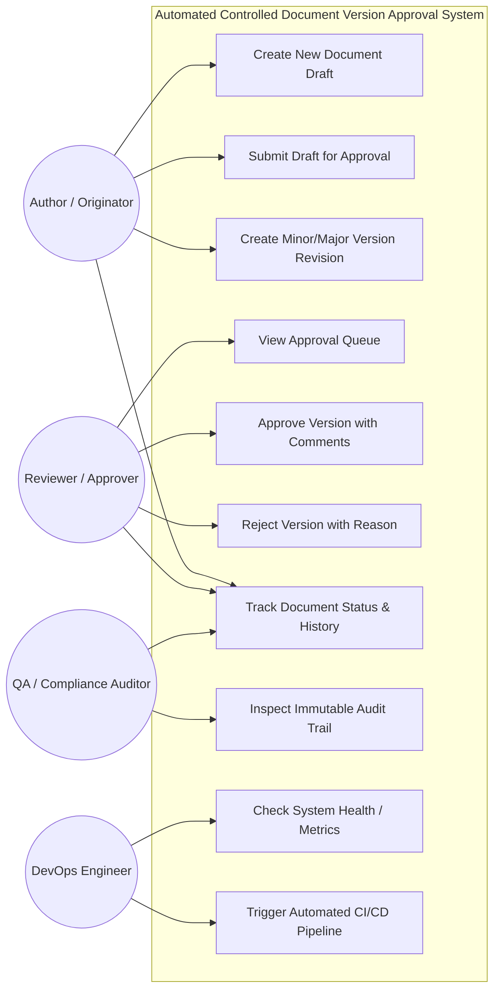
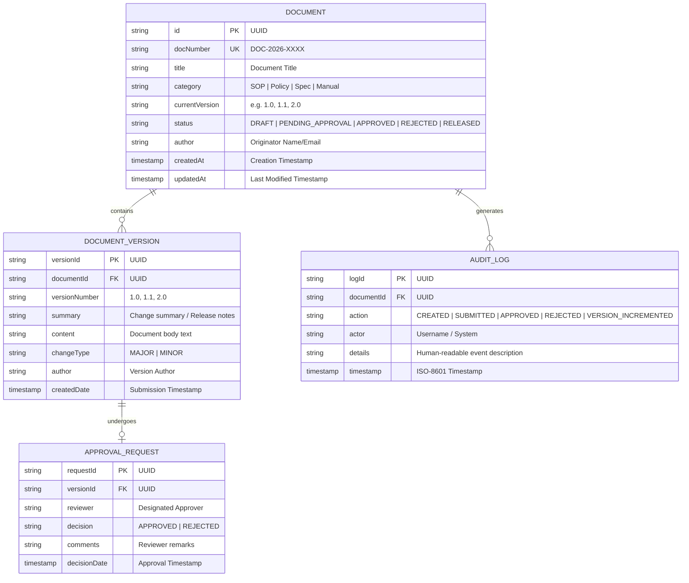
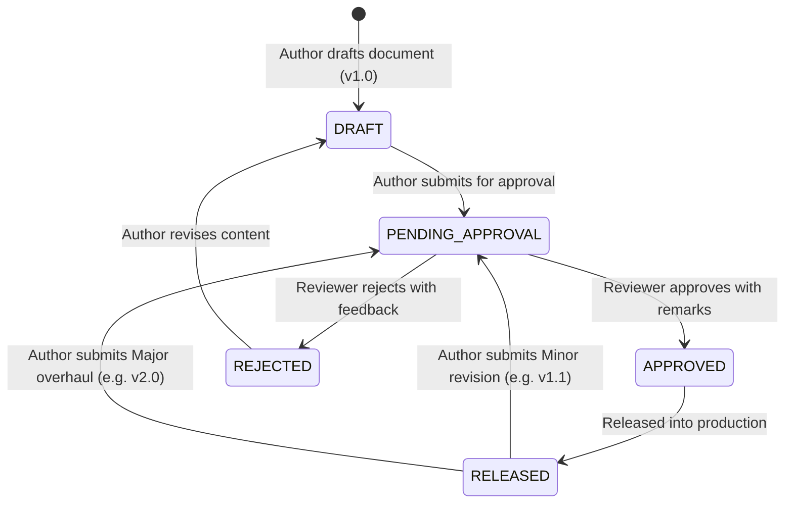

# Software Requirements Specification (SRS) & Architecture Document
## Project: Automated Controlled Document Version Approval System

---

## 1. Executive Summary & Problem Definition

### 1.1 Problem Statement
In regulated industries (such as healthcare, aerospace, financial services, and ISO 9001/CMMI-certified software organizations), Standard Operating Procedures (SOPs), policy manuals, technical specifications, and release artifacts cannot simply be edited in place. Uncontrolled modifications introduce compliance violations, operational downtime, and legal liability. 

Existing traditional approaches rely on manual email exchanges, shared network drives, or fragmented paper-based routing sheets. These legacy methods suffer from:
- Lack of centralized traceability and tamper-evident audit trails.
- High risk of using obsolete or unapproved document versions in production.
- Ambiguous approval chains leading to bottlenecks and lost change requests.
- Absence of automated version increments (Major vs. Minor version semantics).

### 1.2 Proposed Solution: Automated Controlled Document Version Approval System
The **Automated Controlled Document Version Approval System** is a lightweight, high-integrity web application built with **Java 17, Maven, and Apache Tomcat (via Spring Boot Web)**. It automates the entire controlled document lifecycle:
1. **Creation & Drafting:** Authors initiate document records with metadata, categorization, and version 1.0 drafts.
2. **Controlled Modification & Versioning:** Modifications trigger semantic version branching (e.g., v1.1 for minor errata; v2.0 for major policy changes).
3. **Formal Review & Electronic Sign-off:** Documents transition to a `PENDING_APPROVAL` gate where designated reviewers approve or reject changes with mandatory review notes.
4. **Immutable Audit Logging:** Every lifecycle event (creation, submission, approval, rejection, version release) is captured with timestamps and actor identities in an append-only audit trail.
5. **Continuous DevOps Integration:** Packaged and delivered through an automated CI/CD pipeline using Maven, Jenkins, Docker, and Selenium.

---

## 2. Target Users, Stakeholders & Pain Points

| Stakeholder / Role | Key Responsibilities | Existing Pain Points | System Benefits |
|---|---|---|---|
| **Author / Originator** | Creates drafts, writes technical specifications, submits revisions. | Unclear status of submitted drafts; accidental overwrites of existing drafts. | Single portal to draft, track review progress, and submit version bumps. |
| **Reviewer / Approver** (Lead, Dept Head) | Inspects document content, verifies compliance, approves or rejects with feedback. | Overwhelmed with email requests; difficulty comparing versions. | Dedicated approval queue with one-click approval/rejection and comment logging. |
| **QA / Compliance Auditor** | Audits change history, verifies adherence to ISO/SOP standards. | Manual inspection of email logs; no immutable proof of who approved what. | Instant access to chronological, immutable audit logs with timestamps. |
| **DevOps / Release Engineer** | Packages, tests, containers, and deploys the system reliably. | Inconsistent manual deployments, lack of regression test suites. | Standardized Maven build, Dockerized deployment, automated Selenium tests. |

---

## 3. Measurable Success Criteria & Constraints

### 3.1 Measurable Objectives
- **Zero Unapproved Releases:** 100% of released documents must have a recorded approval timestamp and reviewer signature.
- **Traceability:** 100% of document modifications must generate a corresponding audit log entry.
- **Cycle Time Reduction:** Reduce document approval turnaround time from days to under 2 hours.
- **API Performance:** 95% of document retrieval and status transition requests respond in `< 150 ms`.

### 3.2 System Constraints
- **Stack Constraint:** Java 17, Apache Maven build system, Apache Tomcat web runtime (Spring Boot Embedded Tomcat).
- **Audit Immutability:** Audit trail records cannot be edited or deleted through any client API.
- **State Transition Guard:** An unapproved draft cannot directly enter the `RELEASED` state without passing the `APPROVED` gate.

---

## 4. 15-Task MVP Scope Breakdown

| Task ID | Component / Module | Scope Description |
|---|---|---|
| **TASK-01** | Architecture & SRS | Finalize SRS summary, Use-Case diagram, Architecture diagram, and Data Model. |
| **TASK-02** | Project Skeleton & Maven | Initialize Maven multi-tier structure with Java 17 and Spring Boot Web / Tomcat. |
| **TASK-03** | Core Data Model | Implement `Document`, `DocumentVersion`, `ApprovalStatus`, and `AuditLog` domain entities. |
| **TASK-04** | Document Repository | Build in-memory thread-safe repository layer with search, filter, and persistence hooks. |
| **TASK-05** | Document Service Layer | Implement business logic for state transitions, validation, and semantic versioning. |
| **TASK-06** | Audit Trail Service | Implement append-only event logging for all CRUD and status transition operations. |
| **TASK-07** | RESTful API Controllers | Expose endpoints for document creation, versioning, submission, approval, and logs. |
| **TASK-08** | Request Validation & Error Handling | Enforce field constraints (non-empty title, valid enum transitions) with clean error responses. |
| **TASK-09** | Health Check & Metrics | Implement `/api/health` endpoint for DevOps readiness and liveness probes. |
| **TASK-10** | Modern Web Frontend | Build responsive Glassmorphic dashboard (HTML5, Vanilla CSS3, modern JavaScript). |
| **TASK-11** | Document Submission UI | Implement client-side submission form with category selection and real-time validation. |
| **TASK-12** | Approval Queue UI | Implement review modal with approve/reject actions and mandatory feedback remarks. |
| **TASK-13** | Version History & Diff Viewer | Implement side-by-side or chronological version timeline displaying revisions. |
| **TASK-14** | Audit Log Timeline UI | Build compliance view rendering chronological audit events with role badges. |
| **TASK-15** | Unit & Integration Test Suite | Develop JUnit 5 test cases validating approval transitions, version increments, and audit events. |

---

## 5. System Architecture

### 5.1 Three-Tier Architecture Diagram (Mermaid)

---

## 6. Use-Case Diagram

---

## 7. Data Model & Entity Relationship

---

## 8. State Transition Lifecycle (Document Versioning)

